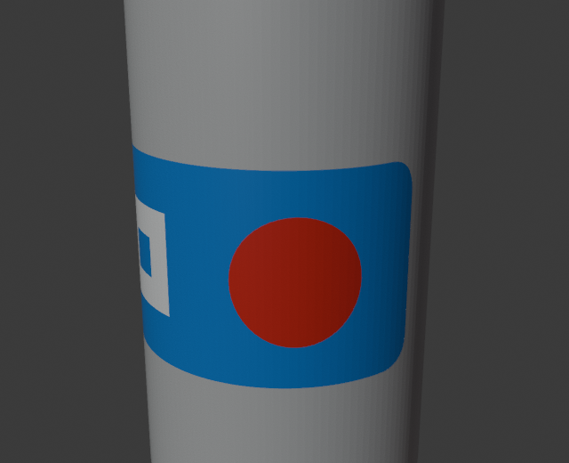

# BlendSVG user guide

BlendSVG puts SVG artwork *into* the surface of a 3D model, like a sticker that sits flush with
the surface. Each color in the SVG becomes its own part, so you can print the design in
different filaments and get a perfectly smooth, multi-color surface.



**What you need**

- Blender 4.5 or newer.
- A model in millimetres: STL, OBJ or PLY.
- An SVG with filled shapes (see [Preparing your SVG](#1-prepare-your-svg)).
- A way to print several colors: an AMS, MMU, tool changer, or manual filament swaps.

---

## 1. Prepare your SVG

BlendSVG uses the **filled shapes** in your SVG. A few minutes in Inkscape (or any vector
editor) avoids most problems:

| Do this | Why |
|---|---|
| Convert text to paths: *Path › Object to Path* | Text is not read as shapes. |
| Convert outlines to shapes: *Path › Stroke to Path* | Stroke-only lines are ignored. |
| Use one solid fill color per part | Each fill color becomes one inlay part. Gradients and transparency aren't supported. |
| Keep the number of colors to what your printer can do | 2–4 colors is typical. |
| Set the document size in mm if you can | The design is imported at the SVG's physical size. You can resize it later. |

Shapes painted on top hide the shapes underneath, exactly as the SVG looks on screen.

---

## 2. Install the add-on

1. Download `blendsvg-<version>.zip` from the
   [latest release](https://github.com/drak42/blendsvg/releases/latest). Don't unzip it.
2. In Blender go to *Edit › Preferences › Get Extensions*, open the **⌄** menu in the top
   right, and choose **Install from Disk…**. Pick the zip.
3. Close Preferences. In the 3D viewport press **N** to open the sidebar and click the
   **BlendSVG** tab.

---

## 3. Make your first sticker

The panel walks you through three steps.

### Step 0: Choose the model

Import your model (*File › Import › STL*). Pick it in the **Model** field at the top of the
BlendSVG panel. If the model is selected when you import the SVG, it's filled in for you.

### Step 1: Place the stamp

1. *(Optional, but the quickest way to aim.)* Put the 3D cursor where the sticker should go.
   Pick the **Cursor** tool in the toolbar. In its tool settings, turn on **Surface Project**
   and set **Orientation** to **Geometry**. Then click on the model. The cursor now sits on
   the surface, facing out.
2. Click **Import SVG Stamp** and pick your SVG.

The SVG appears as a **stamp**: a flat preview of your artwork with an **arrow**. The arrow
always points **away from the surface**, toward you, like the back of a sticker facing you.

Adjust it like any Blender object. Select the stamp (click its arrow) and use:

- **G** to move, **R** to rotate, **S** to scale.
- **Align to Face** to centre it on the model's top, front, side, etc. Pick the face in the
  dropdown first. It keeps your current scale.
- **Stamp to Cursor** to jump to the 3D cursor again.

> **Tip:** The stamp doesn't need to touch the model. BlendSVG looks along the arrow to find
> the surface, so you can leave the stamp floating in front of it.

### Step 2: Cut

Choose a mode:

| Mode | Best for | How it behaves |
|---|---|---|
| **Wrap** (default) | Curved surfaces: bottles, mugs, tubes, rounded shapes | Bends around the surface like a paper sticker and keeps its size along the surface. It's centred where the arrow hits. |
| **Project** | Flat faces, or when you want a straight-on look | Shines straight along the arrow like a projector. It stretches on slopes and can't reach around a curve. |

Then check the two settings:

- **Depth (mm):** how deep the colored inlay goes. The default **0.6 mm** is three layers
  at 0.2 mm, which is plenty for solid color. Go deeper if light colors look see-through.
- **Min wall (mm):** material that always stays under the inlay, so the cut never breaks
  through the other side. The default is **0.8 mm**.

Leave **Reduce depth on thin walls** on, and click **Blend**.

You get a new collection, **BlendSVG ‹model›**, with:

- **‹model› base:** your model with the pocket cut out.
- **‹model› inlay #rrggbb:** one part per color, named after its color.

Your original model and the stamp are hidden, not deleted.

To change something, press **Ctrl+Z** to undo the blend, adjust the stamp or the settings,
and click **Blend** again.

### Step 3: Export

With the base and inlays selected (they are selected after a blend), click **Export Parts**.
In the file dialog's side panel, choose the format:

- **3MF (one object, parts):** recommended. One file with all parts already lined up.
- **STL files:** one file per part, named `‹file›-‹part›.stl`.

---

## 4. Print it

1. Open the `.3mf` in your slicer (PrusaSlicer, OrcaSlicer, Bambu Studio…). The base and
   inlays come in as one object made of several parts. If the slicer asks whether to load
   the file as a single object with multiple parts, answer **Yes**.
2. Assign a filament to each part: the base color to the base, and each inlay its color
   (the part names include the color code).
3. Slice and print as usual.

Using STL files instead? Load all of them together and keep them as parts of one object, so
they stay aligned.

---

## 5. Command line (optional)

You can do the same without opening Blender. That's handy for batches.

It runs from a copy of the repository (`git clone https://github.com/drak42/blendsvg.git`)
and needs `blender` on your `PATH`.

```bash
bin/blendsvg mug.stl logo.svg --face front --width 50
```

This wraps `logo.svg` onto the front of `mug.stl`, 50 mm wide, and writes `mug-blend.3mf`
next to the model.

| Option | What it does |
|---|---|
| `--face top/bottom/front/back/left/right` | Which side of the model to decorate (default: top) |
| `--width MM` / `--height MM` / `--scale X` | Artwork size (default: the SVG's own size) |
| `--offset RIGHT UP` | Move the artwork, in mm, as seen looking at the face |
| `--rotate DEG` | Rotate counter-clockwise |
| `--at X Y Z` | Centre the artwork on this point instead of the model's centre |
| `--project` | Use Project mode instead of Wrap |
| `--depth MM` / `--min-wall MM` | Same as in the panel (defaults 0.6 / 0.8) |
| `--no-clamp` | Stop with an error instead of making the pocket shallower |
| `--single-color` | Merge all SVG colors into one inlay |
| `--stl` | Also write STL files |
| `--save-blend FILE.blend` | Save the result to open and adjust in Blender |
| `-o FILE.3mf` | Output file name |

Run `bin/blendsvg --help` for the full list.

---

## 6. Troubleshooting

| Message | What it means | What to do |
|---|---|---|
| *the artwork does not land on the model* / *the stamp's centre does not point at the model* | Looking along the arrow, there's no model behind the stamp. | Move the stamp in front of the surface, with its arrow pointing away from the model. In Wrap mode, the centre of the stamp must point at the model. |
| *part of the artwork runs off the surface it is wrapped onto* | In Wrap mode, the sticker would run past an open edge of the mesh, or so far around the model that it overlaps itself. | Make the artwork smaller, or move the stamp toward the middle of the surface. |
| *N% of the artwork hangs off the edge of the surface* | In Project mode, part of the design misses the model. That part is left out. | Fine if intended. Otherwise move or shrink the stamp. |
| *wall under the artwork is only X mm thick; depth reduced* | The model is thin there, so the pocket was made shallower to keep **Min wall**. | Usually fine. For more depth, use a thicker part of the model or lower **Min wall**. |
| *the wall under the artwork is only X mm thick; … less than the minimum wall* | The model is too thin to cut safely (or **Reduce depth** is off). | Lower **Depth** or **Min wall**, or move the stamp to a thicker area. |
| *N stroke-only path(s) ignored* | Some lines in the SVG are outlines without a fill. | Convert them with *Path › Stroke to Path* if you want them. |
| *no filled shapes found* | The SVG has no filled shapes (for example, only text or outlines). | See [Prepare your SVG](#1-prepare-your-svg). |
| *… is not watertight; using the slower exact solver* | The model has holes or broken faces. | It usually still works. If the result has holes, repair the model first (most slicers have a "fix model" option). |

**The design looks stretched.** In Project mode this happens on slopes; switch to **Wrap**. In
Wrap mode, a little distortion away from the centre is normal on ball-like shapes, just as a
real sticker can't lie perfectly flat on a ball. Smaller stickers distort less.

**The design is mirrored or upside down.** Rotate the stamp (**R**, then **Z**) or flip its
arrow by rotating it 180° around its X axis, so it points away from the surface.

**Colors bleed or look thin.** Increase **Depth** (try 0.8–1.0 mm) and check that the inlay
parts have the right filaments in the slicer.
